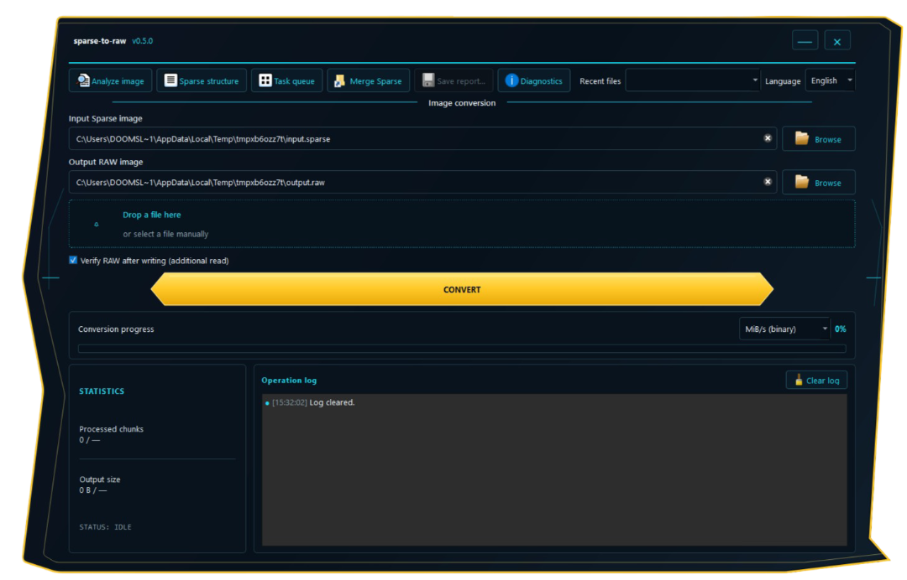

# sparse-to-raw

A streaming Android Sparse Image v1 inspector and converter that expands Sparse images to logical RAW content. The project provides a dependency-free Python CLI and a PySide6 desktop GUI for Windows.

[](https://github.com/LIJTA3U/sparse-to-raw/actions/workflows/tests.yml)
[](https://www.python.org/)
[](LICENSE)
[](#requirements)

**Language:** English · [Русский](README.ru.md)

> **Status: experimental.** The implementation was compared byte-for-byte with `simg2img.exe` using two Android images: `super.img` (approximately 3.6 GB) from Blackview factory firmware and `userdata_exp.ai.img` (approximately 6.83 GB) from Google Pixel factory firmware. No differences were found in either comparison. These results apply to those two files and do not replace independent testing on other images and devices.

## Features

- Convert Android Sparse Image format v1 to logical RAW output.
- Support `RAW`, `FILL`, `DONT_CARE`, and `CRC32` chunks.
- Validate per-chunk CRC32, the image checksum, headers, block sizes/counts, truncation, and trailing bytes.
- Inspect or verify an image without creating a RAW file (`--info`, `--verify-only`).
- Protect existing output files by default; `--force` is required to replace them.
- Report progress, throughput, processed bytes, and chunk counts.
- Optionally calculate SHA-256 over the logical RAW contents and export JSON reports.
- Verify a completed RAW staging file by re-reading it and comparing its size and SHA-256 with the expected logical contents (`--verify-output`).
- Merge independent Sparse images in an explicitly supplied order (`--merge-parts`).
- Analyze Qualcomm QFIL `rawprogram*.xml` / `patch*.xml`, resolve referenced firmware files, summarize partitions, and assemble one RAW image per physical partition (`qfil-analyze`, `qfil-build`). Patch instructions are reported but not replayed.
- Stream large images without loading the complete input or output into memory.
- Use only the Python standard library for the CLI.
- Provide a PySide6 GUI with Russian/English language selection, saved preferences, recent files, image analysis, sequential batch conversion, visual ordered merging, optional output verification, a searchable Diagnostic Center, and a paged Sparse Structure Viewer with streaming CSV/JSON export.

`DONT_CARE` ranges are interpreted as zero bytes. The resulting logical RAW contents and size are correct; the filesystem may store zero ranges as sparse holes.

## Download for Windows

**Release:** [sparse-to-raw v0.5.0](https://github.com/LIJTA3U/sparse-to-raw/releases/tag/v0.5.0)

The release provides:

- `sparse-to-raw-gui-windows.zip` — recommended GUI package. Extract the entire folder and run `sparse-to-raw-gui.exe` from inside it.
- `sparse-to-raw-gui.exe` — standalone GUI executable.
- `sparse-to-raw.exe` — standalone CLI executable.

End users do not need to install Python to run the packaged Windows applications. The folder ZIP is recommended for normal use; keep the extracted directory structure intact.

## Windows GUI

The GUI uses a dark theme with an angular yellow frame and cyan accents. It supports drag-and-drop, progress statistics, an operation log, saved settings, recent input files, and speed display in decimal MB/s, binary MiB/s, or Mbit/s.



The **Analyze image** action verifies metadata without creating a RAW output. **Task queue** processes multiple files sequentially and writes a JSON summary. **Merge Sparse** lets the user reorder independent Sparse images before merging. Conversion and analysis run in Qt worker threads; cancellation removes staging output and preserves an existing destination.

See the [GUI guide](docs/en/gui-guide.md) and [Windows installation guide](docs/en/installation.md).

## Quick start (CLI)

Python 3.10 or newer is required when running from source. The CLI has no third-party package dependencies. The CLI uses English by default; select Russian with `--lang ru` or `SPARSE_TO_RAW_LANG=ru`. See the [CLI guide](docs/en/cli-guide.md) for details.

```bash
python sparse_to_raw.py input_sparse.img output_raw.img
```

On Windows Command Prompt:

```bat
py sparse_to_raw.py super.img super_raw.img
```

If the destination exists, conversion stops without replacing it. To explicitly allow replacement:

```bat
py sparse_to_raw.py super.img super_raw.img --force
```

Inspect and validate without conversion:

```bash
python sparse_to_raw.py super.img --info
python sparse_to_raw.py super.img --verify-only
```

Calculate the logical RAW SHA-256 and save a report:

```bash
python sparse_to_raw.py super.img super_raw.img --sha256 --json-report report.json
```

Merge independent Sparse files in the order supplied:

```bat
py sparse_to_raw.py --merge-parts super.img_sparsechunk.0 super.img_sparsechunk.1 --output super_raw.img --sha256
```

Each merge input must be a complete, independent Sparse image with its own header. This mode is not intended for arbitrary byte-level pieces cut from one Sparse file. The GUI can discover groups of `super.img_sparsechunk.*` files and sort their parts numerically. The CLI `--merge-parts` option continues to accept an explicitly ordered list of independent Sparse images.

For Qualcomm manifests, see the [QFIL XML guide](docs/en/qfil-xml.md). For all CLI options, examples, and exit behavior, see the [CLI guide](docs/en/cli-guide.md). The CLI also supports `--verify-output`, which re-reads the staged RAW result before it is committed.

## Documentation

- [Installation](docs/en/installation.md)
- [CLI guide](docs/en/cli-guide.md)
- [Qualcomm QFIL XML support](docs/en/qfil-xml.md)
- [RAW output verification](docs/en/output-verification.md)
- [GUI guide](docs/en/gui-guide.md)
- [Task queue guide](docs/en/task-queue.md)
- [Diagnostic Center](docs/en/diagnostic-center.md)
- [Sparse Structure Viewer](docs/en/sparse-structure-viewer.md)
- [Development and packaging](docs/en/development.md)
- [Changelog](docs/en/changelog.md)
- [Contributing](docs/CONTRIBUTING.md)
- [Security policy](docs/SECURITY.md)
- [Screenshots](docs/screenshots/)

The [Russian README](README.ru.md) links to the Russian documentation in `docs/ru/`.

## Current development

The v0.6.0-dev6 development build refines the main toolbar into two rows so action labels, icons, recent files, and language controls fit without crowding. The v0.6.0-dev4 development build adds QFIL XML analysis and RAW assembly to the dependency-free CLI, improves the drop-zone icon, and presents a clearer CLI summary. The CLI language can now be selected with `--lang en|ru` (English is the default). The QFIL backend is now available in a dedicated GUI dialog from the main toolbar and from the Batch Queue window. The dialog supports manifest selection, optional firmware search folders, analysis, overlap review, and RAW assembly; QFIL jobs can now be added to the same sequential Batch Queue as Sparse conversions. Active QFIL assembly is currently non-interruptible; cancellation takes effect at the next safe task boundary. The v0.5.0 release includes automatic GUI discovery and numeric ordering of Sparse parts, preflight disk-space and path checks, optional read-back verification of completed RAW output, advanced batch-queue controls, the searchable Diagnostic Center, and the paged Sparse Structure Viewer. It also includes localized operation-log messages, a dedicated Windows taskbar identity and application icon, and a smoother version of the existing angular frame. See the [changelog](docs/en/changelog.md) for the complete release history. The earlier v0.4.0 release remains available on the [GitHub releases page](https://github.com/LIJTA3U/sparse-to-raw/releases/tag/v0.4.0).

## Tests

Run the complete test suite from the repository root:

```bash
python -m unittest discover -s tests -v
```

The core suite covers chunk types, checksums, malformed and truncated data, safe output handling, info/verification modes, merging, SHA-256, JSON reports, progress callbacks, and cancellation. GUI smoke tests cover path validation, widgets, language and speed settings, recent files, worker integration, analysis, batch conversion, and the packaged self-test entry point. GitHub Actions runs core tests on Python 3.10–3.13 on Windows and Linux; GUI smoke tests run on Windows and Linux with PySide6.

## Limitations and safety

- This is an experimental project, not an official AOSP `simg2img` replacement.
- Independent byte-for-byte comparisons were performed on the two real images named above. Verify outputs independently before using them for critical work.
- The utility works with files only. It does not communicate with phones or flash device partitions.
- Check input/output paths and available disk space before conversion. Merging needs staging space for the combined output and the currently expanded part.
- The GUI can automatically discover and numerically sort Sparse part groups. The CLI `--merge-parts` option still requires independent Sparse images to be supplied in the correct order.

## References

- [AOSP `sparse_format.h`](https://android.googlesource.com/platform/system/core/+/refs/heads/main/libsparse/include/sparse/sparse_format.h)
- [AOSP `sparse_read.cpp`](https://android.googlesource.com/platform/system/core/+/refs/heads/main/libsparse/sparse_read.cpp)
- [AOSP `simg2img.cpp`](https://android.googlesource.com/platform/system/core/+/refs/heads/main/libsparse/simg2img.cpp)

## License

[MIT](LICENSE).


## RAW → Android Sparse

The dependency-free CLI can encode a RAW image as Android Sparse v1.0 using bounded-memory streaming. It detects zero blocks and writes `DONT_CARE` chunks, detects repeated 4-byte patterns and writes `FILL` chunks, and stores other data in `RAW` chunks. The block size is configurable (default 4096 bytes; must be a multiple of 4). Input size must be non-zero and divisible by the selected block size.

```bash
python sparse_to_raw.py raw-to-sparse system.raw system.sparse --block-size 4096 --sha256
```

Use `--force` to replace an existing output and `--json-report report.json` to save a machine-readable summary. The operation writes to a temporary file and only commits the finished Sparse image after successful encoding.
