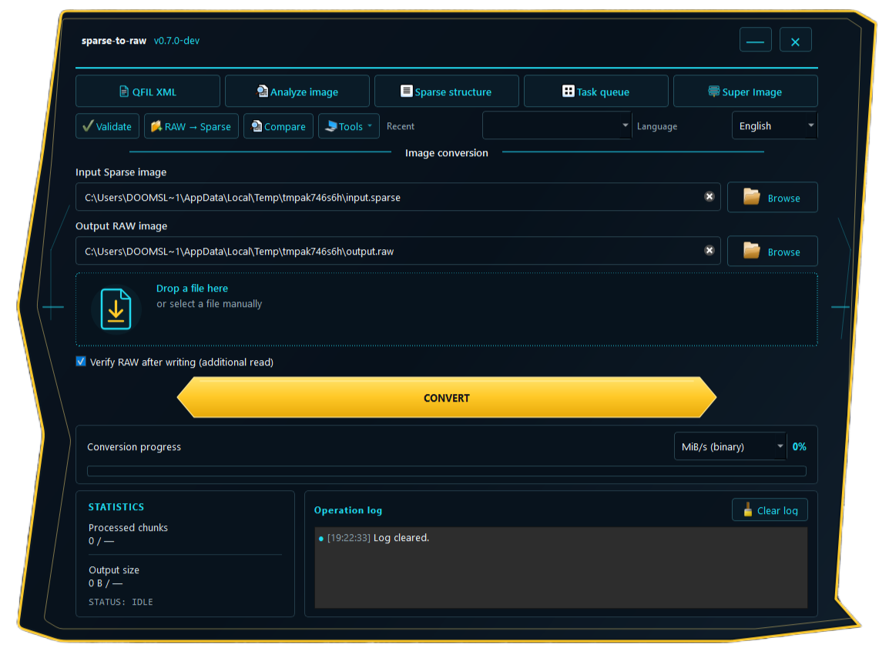

# sparse-to-raw

A streaming Android Sparse Image v1 inspector and converter that expands Sparse images to logical RAW content. The project provides a dependency-free Python CLI and a PySide6 desktop GUI for Windows.

[](https://github.com/LIJTA3U/sparse-to-raw/actions/workflows/tests.yml)
[](https://www.python.org/)
[](LICENSE)
[](#requirements)

**Language:** English · [Русский](README.ru.md)

> **Project status: v0.7.0 is in development; v0.6.0 remains the latest stable release.** Byte-by-byte comparisons with AOSP `simg2img.exe` were completed on two real factory images: Blackview `super.img` and Google Pixel `userdata_exp.ai.img`; both matched with no differences. The v0.7.0 development tools have also been exercised on real Blackview RAW and Android Sparse `super.img` inputs through the CLI and GUI, with extracted partition SHA-256 values matching between both interfaces, and with a synthetic multi-extent fixture. Several users have separately reported successful tests on additional firmware. One reported scenario used an Android 13 `super.img` on Windows 11: conversion completed and `system.img` extraction succeeded. These user reports are useful compatibility evidence, not a comprehensive certification; they do not guarantee support for every Sparse variant, device, firmware, or Dynamic Partitions layout. Testing individual `super.img` files does not imply support for arbitrary `super_*` sets or every retrofit layout.

## Features

- Convert Android Sparse Image format v1 to logical RAW output and encode RAW files as Android Sparse v1.0.
- Support `RAW`, `FILL`, `DONT_CARE`, and `CRC32` chunks.
- Validate per-chunk CRC32, the image checksum, headers, block sizes/counts, truncation, and trailing bytes with the standalone Sparse Validator.
- Inspect or verify an image without creating a RAW file (`--info`, `--verify-only`).
- Protect existing output files by default; `--force` is required to replace them.
- Report progress, throughput, processed bytes, and chunk counts.
- Optionally calculate SHA-256 over the logical RAW contents and export JSON reports.
- Verify a completed RAW staging file by re-reading it and comparing its size and SHA-256 with the expected logical contents (`--verify-output`).
- Merge independent Sparse images in an explicitly supplied order (`--merge-parts`).
- Compare RAW and/or Android Sparse images by logical contents without creating intermediate RAW files (`compare`); report the first differing byte and both logical SHA-256 hashes.
- Save and reload versioned JSON Batch Profiles for mixed Sparse → RAW, RAW → Sparse, and QFIL queues.
- Export detailed JSON reports for conversions, output verification, validation, comparison, QFIL operations, and batch runs.
- Analyze Qualcomm QFIL `rawprogram*.xml` / `patch*.xml`, resolve referenced firmware files, and assemble one RAW image per physical partition (`qfil-analyze`, `qfil-validate`, `qfil-build`). Full preflight validates RAW ranges and Sparse CRCs without creating outputs; patch instructions are reported but not replayed.
- Inspect Android Verified Boot metadata with `vbmeta-info`: parse standalone VBMeta or AVB-footer images, review rollback indexes, flags, key fingerprints, hash/hashtree/chain/property descriptors, and check the embedded VBMeta digest. RSA signatures and key trust are not verified.
- Inspect Android boot images with `boot-info`: parse legacy boot headers v0–v2, generic boot headers v3–v4, and `vendor_boot` v3–v4; display component offsets/sizes, OS version, command line, kernel/ramdisk compression-signature hints, DTB, v4 boot signature, vendor ramdisk fragments, and structural AVB-footer/VBMeta range details. The inspector is read-only, does not unpack components, and does not verify AVB signatures.
- Inspect Android ramdisk CPIO inventories and safely extract selected paths with `ramdisk-info` / `ramdisk-extract`. Supports boot/init_boot/recovery, `vendor_boot` v3/v4 fragment selection, standalone CPIO, newc/crc archives, gzip/bzip2/XZ/LZMA-alone/LZ4 frame and legacy decompression, JSON reports, bounded decompression, and safe path checks. The GUI adds path search, category filters (files, directories, symlinks, executables, configuration files), UID/GID columns, automatic preview when selecting a regular file (up to 256 KiB, with HEX preview for binary data; Android fstab variants such as `fstab.mt6762` and `fstab.mt6765` are treated as text), selective extraction of selected files/directories, and GUI side-by-side comparison of two configuration files with added/deleted/modified line highlighting. Zstandard and LZO/lzop are detected but not decompressed in the dependency-free build; symlinks and special filesystem nodes are listed rather than created.
- Inspect Android Dynamic Partitions metadata (`super-info`) and extract selected logical partitions from RAW/Sparse `super.img` (`super-extract`), including LP geometry and metadata SHA-256 checks and backup-metadata fallback.
- Stream large images without loading the complete input or output into memory.
- Use only the Python standard library for the CLI.
- Provide a PySide6 GUI with a dedicated RAW → Sparse dialog and mixed batch-queue support, plus Russian/English language selection, saved preferences, recent files, logical RAW/Sparse comparison, image analysis, sequential batch conversion, visual ordered merging, optional output verification, a searchable Diagnostic Center, and a paged Sparse Structure Viewer with streaming CSV/JSON export, a Super Image dialog for partition inspection/extraction, AVB / VBMeta, Boot Image, and Ramdisk Inspectors in the Tools menu, and JSON reports.

`DONT_CARE` ranges are interpreted as zero bytes. The resulting logical RAW contents and size are correct; the filesystem may store zero ranges as sparse holes.

## Download for Windows

**Latest stable release:** [sparse-to-raw v0.6.0](https://github.com/LIJTA3U/sparse-to-raw/releases/tag/v0.6.0). Windows applications are built and attached by GitHub Actions.

The release provides:

- `sparse-to-raw-gui-windows.zip` — recommended GUI package. Extract the entire folder and run `sparse-to-raw-gui.exe` from inside it.
- `sparse-to-raw-gui.exe` — standalone GUI executable.
- `sparse-to-raw.exe` — standalone CLI executable.

End users do not need to install Python to run the packaged Windows applications. The folder ZIP is recommended for normal use; keep the extracted directory structure intact.

## Windows GUI

The v0.7.0 development branch uses a compact two-row toolbar: primary sections are grouped in the first row, common actions in the second, and less-frequent actions are in the Tools menu. The new Super Image dialog inspects Dynamic Partitions metadata and extracts selected partitions. The Tools menu also includes the read-only AVB / VBMeta and Boot Image Inspectors, plus the Ramdisk Inspector for CPIO inventory, safe extraction, and side-by-side configuration comparison. See the [Super Image guide](docs/en/super-image.md), [AVB / VBMeta guide](docs/en/avb-vbmeta.md), [Boot Image guide](docs/en/boot-image.md), and [Ramdisk guide](docs/en/ramdisk-inspector.md).

The GUI uses a dark theme with an angular yellow frame and cyan accents. It supports drag-and-drop, progress statistics, an operation log, saved settings, recent input files, and speed display in decimal MB/s, binary MiB/s, or Mbit/s.



The **Analyze image** action verifies metadata without creating a RAW output. **Task queue** processes multiple files sequentially and writes a JSON summary. **Merge Sparse** lets the user reorder independent Sparse images before merging. Conversion and analysis run in Qt worker threads; cancellation removes staging output and preserves an existing destination.

See the [GUI guide](docs/en/gui-guide.md) and [Windows installation guide](docs/en/installation.md).

## Quick start (CLI)

Python 3.10 or newer is required when running from source. The CLI has no third-party package dependencies. The CLI uses English by default; select Russian with `--lang ru` or `SPARSE_TO_RAW_LANG=ru`. See the [CLI guide](docs/en/cli-guide.md) for details.

```bash
python sparse_to_raw.py input_sparse.img output_raw.img
```

On Windows Command Prompt:

```bat
py sparse_to_raw.py super.img super_raw.img
```

If the destination exists, conversion stops without replacing it. To explicitly allow replacement:

```bat
py sparse_to_raw.py super.img super_raw.img --force
```

Inspect and validate without conversion:

```bash
python sparse_to_raw.py super.img --info
python sparse_to_raw.py super.img --verify-only
```

Calculate the logical RAW SHA-256 and save a report:

```bash
python sparse_to_raw.py super.img super_raw.img --sha256 --json-report report.json
```

Compare two images by their logical contents (RAW and/or Android Sparse):

```bat
py sparse_to_raw.py compare left.raw right.sparse --json-report comparison.json
```

The command returns exit code `0` when the images are identical, `1` when they differ, and `2` when comparison cannot be completed. It does not create an intermediate RAW file.

Merge independent Sparse files in the order supplied:

```bat
py sparse_to_raw.py --merge-parts super.img_sparsechunk.0 super.img_sparsechunk.1 --output super_raw.img --sha256
```

Each merge input must be a complete, independent Sparse image with its own header. This mode is not intended for arbitrary byte-level pieces cut from one Sparse file. The GUI can discover groups of `super.img_sparsechunk.*` files and sort their parts numerically. The CLI `--merge-parts` option continues to accept an explicitly ordered list of independent Sparse images.

Inspect Android boot and vendor boot metadata with `py sparse_to_raw.py boot-info boot.img --json-report boot-report.json`. Inspect a ramdisk CPIO inventory with `py sparse_to_raw.py ramdisk-info boot.img`; extract it with `py sparse_to_raw.py ramdisk-extract boot.img --output-dir ramdisk-files`. For `vendor_boot` v4 with multiple fragments, add `--fragment-index N`. For Qualcomm manifests, see the [QFIL XML guide](docs/en/qfil-xml.md). For all CLI options, examples, and exit behavior, see the [CLI guide](docs/en/cli-guide.md). The CLI also supports `--verify-output`, which re-reads the staged RAW result before it is committed.

## Documentation

- [Installation](docs/en/installation.md)
- [CLI guide](docs/en/cli-guide.md)
- [Qualcomm QFIL XML support](docs/en/qfil-xml.md)
- [AVB / VBMeta inspection](docs/en/avb-vbmeta.md)
- [Android Boot Image inspection](docs/en/boot-image.md)
- [Android Ramdisk inspection and extraction](docs/en/ramdisk-inspector.md)
- [RAW output verification](docs/en/output-verification.md)
- [GUI guide](docs/en/gui-guide.md)
- [Task queue guide](docs/en/task-queue.md)
- [Diagnostic Center](docs/en/diagnostic-center.md)
- [Sparse Structure Viewer](docs/en/sparse-structure-viewer.md)
- [Development and packaging](docs/en/development.md)
- [v0.7.0 release checklist](docs/en/release-checklist.md)
- [v0.6.0 release notes](RELEASE_NOTES_v0.6.0.md)
- [Changelog](docs/en/changelog.md)
- [Contributing](docs/CONTRIBUTING.md)
- [Security policy](docs/SECURITY.md)
- [Screenshots](docs/screenshots/)

The [Russian README](README.ru.md) links to the Russian documentation in `docs/ru/`.

## v0.6.0 stable release

The stable `v0.6.0` release brings together RAW → Sparse conversion, logical RAW/Sparse comparison without intermediate RAW files, the standalone Sparse Validator, reusable JSON Batch Profiles, expanded QFIL integration, structured JSON reports, and automated Windows CLI/GUI packaging. Windows release artifacts were built by GitHub Actions and the packaged application was confirmed to run on a Windows computer without Python installed. See the [English changelog](docs/en/changelog.md) or [русскую историю изменений](docs/ru/changelog.md) for details.

## Tests

Run the complete test suite from the repository root:

```bash
python -m unittest discover -s tests -v
```

The core suite covers chunk types, checksums, malformed and truncated data, safe output handling, info/verification modes, merging, SHA-256, JSON reports, progress callbacks, and cancellation. The three small binary Super Image regression fixtures under `tests/fixtures/` are explicitly unignored in `.gitignore` and must be included in commits; CI checks their presence before running tests. Boot Image Inspector tests cover legacy boot headers v0–v2, generic boot v3–v4, vendor_boot v3–v4, vendor ramdisk tables, section boundaries, and malformed headers. AVB and Dynamic Partitions tests cover their respective metadata and extraction paths. QFIL tests also cover full no-output preflight, including source ranges and Sparse CRC integrity. Ramdisk tests cover gzip/bzip2/XZ/LZMA/LZ4 inputs, CPIO newc/crc parsing, vendor_boot fragment selection, archive CRCs, concatenated archives, path safety, decompression limits, extraction, multi-file reads, and line-diff classification. GUI smoke tests cover path validation, widgets, language and speed settings, recent files, worker integration, analysis, Super Image, AVB/VBMeta, Boot Image and Ramdisk inspector dialogs, including configuration comparison, batch conversion, and the packaged self-test entry point. GitHub Actions runs core tests on Python 3.10–3.14 on Windows and Linux; GUI smoke tests run on Windows and Linux with PySide6.

## Limitations and safety

- The stable v0.6.0 release is not an official AOSP `simg2img` replacement; Super Image tools are part of the current v0.7.0-dev development branch.
- Independent byte-for-byte comparisons were performed only on the two real images named above; this is not broad device/firmware certification.
- `--merge-parts` is only for independent, valid Sparse v1 files and does not reconstruct arbitrary `super` containers. Separate `super-info` / `super-extract` commands parse supported Dynamic Partitions metadata (LP 10.0–10.2), but currently require extracted extents to reference block device index 0. Multi-image retrofit layouts and arbitrary `super_*` sets are not supported. See the [4PDA example](https://4pda.to/forum/index.php?showtopic=496786&st=5460). Verify outputs independently before using them for critical work.
- Boot Image Inspector is a metadata viewer: it does not decompress or extract kernel/ramdisk payloads, interpret DTB contents, verify AVB signatures, or identify `boot`, `recovery`, and `init_boot` partition names from the header alone. The separate Ramdisk Inspector can unpack supported CPIO compression formats, but it does not repack images, create symlinks/special nodes, or restore ownership and SELinux metadata. Zstandard and LZO/lzop are detected but not decompressed in the dependency-free build. `init_boot` is reported only as a probable role when the image shape suggests it.
- The utility works with files only. It does not communicate with phones or flash device partitions.
- Check input/output paths and available disk space before conversion. Merging needs staging space for the combined output and the currently expanded part.
- The GUI can automatically discover and numerically sort Sparse part groups. The CLI `--merge-parts` option still requires independent Sparse images to be supplied in the correct order.

## References

- [AOSP `sparse_format.h`](https://android.googlesource.com/platform/system/core/+/refs/heads/main/libsparse/include/sparse/sparse_format.h)
- [AOSP `sparse_read.cpp`](https://android.googlesource.com/platform/system/core/+/refs/heads/main/libsparse/sparse_read.cpp)
- [AOSP `simg2img.cpp`](https://android.googlesource.com/platform/system/core/+/refs/heads/main/libsparse/simg2img.cpp)

## License

[MIT](LICENSE).


## RAW → Android Sparse

The dependency-free CLI can encode a RAW image as Android Sparse v1.0 using bounded-memory streaming. It detects zero blocks and writes `DONT_CARE` chunks, detects repeated 4-byte patterns and writes `FILL` chunks, and stores other data in `RAW` chunks. The block size is configurable (default 4096 bytes; must be a multiple of 4). Input size must be non-zero and divisible by the selected block size.

```bash
python sparse_to_raw.py raw-to-sparse system.raw system.sparse --block-size 4096 --sha256
```

Use `--force` to replace an existing output and `--json-report report.json` to save a machine-readable summary. The operation writes to a temporary file and only commits the finished Sparse image after successful encoding.
