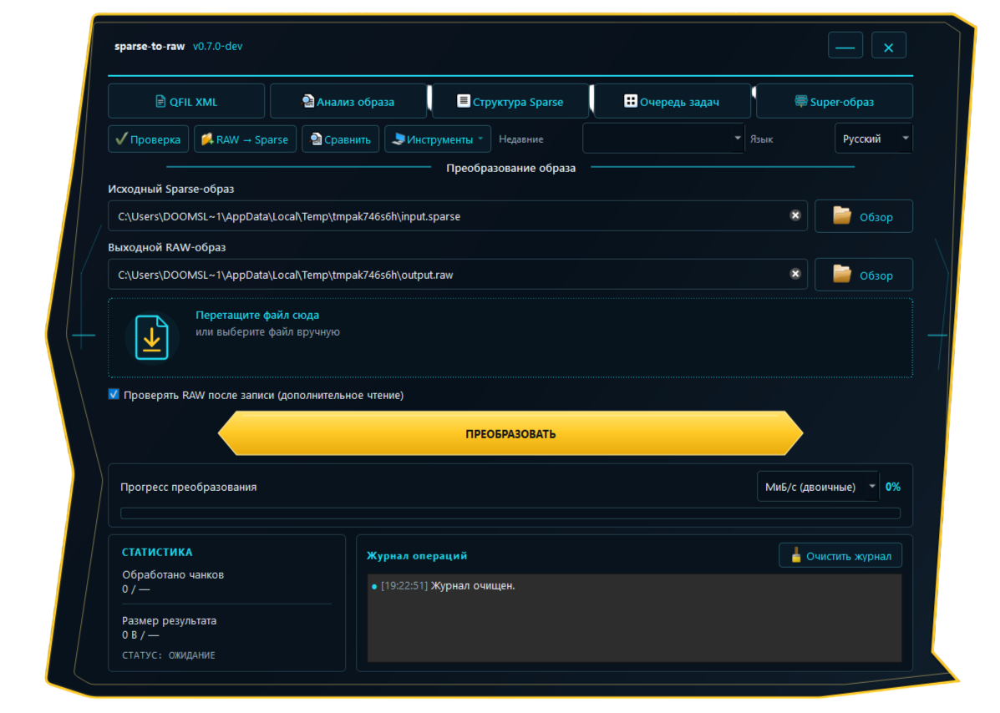

# sparse-to-raw

Потоковая утилита для анализа Android Sparse Image v1 и преобразования Sparse-образов в логическое RAW-содержимое. Проект включает CLI на Python без сторонних зависимостей и графический интерфейс PySide6 для Windows.

[](https://github.com/LIJTA3U/sparse-to-raw/actions/workflows/tests.yml)
[](https://www.python.org/)
[](LICENSE)
[](#требования)

**Язык:** [Русский](README.ru.md) · [English](README.md)

> **Статус: разработка v0.7.0; последняя стабильная версия — v0.6.0.** Побайтное сравнение с `simg2img.exe` выполнено на двух реальных заводских образах: `super.img` из прошивки Blackview и `userdata_exp.ai.img` из прошивки Google Pixel. В обоих случаях различий не обнаружено. Инструменты версии 0.7.0 дополнительно проверялись на реальных RAW- и Android Sparse-файлах `super.img` Blackview через CLI и GUI; SHA-256 извлечённых разделов совпали. Также проверен синтетический образ с несколькими extents. Эти проверки подтверждают отдельные сценарии, но не являются полной сертификацией всех форматов и прошивок.

## Возможности

- Потоковое преобразование Android Sparse Image v1 в логическое RAW-содержимое и кодирование RAW-файлов в Android Sparse v1.0.
- Поддержка чанков `RAW`, `FILL`, `DONT_CARE` и `CRC32`.
- Проверка CRC32 каждого чанка, общей контрольной суммы образа, заголовков, размеров блоков и количества блоков, обрезанных данных и лишних байтов в конце. Отдельный Sparse Validator позволяет проверять образ без создания RAW-файла.
- Анализ и проверка образа без преобразования (`--info`, `--verify-only`).
- Защита существующих выходных файлов: по умолчанию перезапись запрещена, для неё требуется `--force`.
- Отображение прогресса, скорости, объёма обработанных данных и количества чанков.
- Необязательный расчёт SHA-256 логического RAW-содержимого и экспорт JSON-отчётов.
- Проверка готового временного RAW повторным чтением и сравнением размера и SHA-256 с ожидаемым логическим содержимым (`--verify-output`).
- Объединение независимых Sparse-образов в явно указанном порядке (`--merge-parts`).
- Логическое сравнение RAW и/или Android Sparse без промежуточного RAW-файла (`compare`): поиск первого отличающегося байта и расчёт SHA-256 обоих логических содержимых.
- Сохранение и загрузка версионированных JSON-профилей пакетной обработки для смешанных очередей Sparse → RAW, RAW → Sparse и QFIL.
- Подробные JSON-отчёты о конвертации, проверке результата, валидации, сравнении, операциях QFIL и пакетной обработке.
- Анализ Qualcomm QFIL `rawprogram*.xml` / `patch*.xml`, поиск файлов прошивки и сборка отдельного RAW-образа для каждого физического раздела (`qfil-analyze`, `qfil-validate`, `qfil-build`). Preflight проверяет исходные диапазоны и целостность Sparse без создания результатов; инструкции Patch анализируются и отображаются, но не исполняются.
- Просмотр метаданных Android Verified Boot с помощью `vbmeta-info`: самостоятельный `vbmeta.img` или образ раздела с AVB footer, rollback index/location, флаги, отпечатки ключей и дескрипторы hash/hashtree/chain/property. Проверяется встроенный digest VBMeta, но не криптографическая подлинность RSA-подписи или доверие к ключу.
- Анализ Android boot-образов командой `boot-info`: legacy boot headers v0–v2, generic boot headers v3–v4 и `vendor_boot` v3–v4. Отображаются размеры и смещения компонентов, сведения об ОС и командной строке, подсказки о сигнатурах сжатия Kernel/Ramdisk, DTB, recovery DTBO, таблица фрагментов vendor ramdisk и bootconfig. Инспектор не распаковывает компоненты и не проверяет AVB-подписи.
- Инвентаризация CPIO внутри `boot`, `init_boot`, `recovery`, фрагментов `vendor_boot` v3/v4 и отдельных архивов через `ramdisk-info`; безопасное извлечение выбранных путей или всего архива через `ramdisk-extract`.
- Ramdisk Inspector поддерживает CPIO newc/crc, проверку CRC, последовательные архивы, gzip/bzip2/XZ/LZMA-alone/LZ4 frame и legacy decompression, ограничение объёма распаковки, JSON-отчёты и безопасную проверку путей.
- В GUI Ramdisk Inspector есть поиск по имени/пути, фильтры категорий, просмотр текста и HEX, выборочное извлечение файлов и папок, а также построчное сравнение двух конфигурационных файлов с подсветкой добавленных, удалённых и изменённых строк.
- Просмотр метаданных Android Dynamic Partitions (`super-info`) и извлечение логических разделов из RAW/Sparse `super.img` (`super-extract`), включая проверку LP geometry/metadata SHA-256 и переход к резервной копии метаданных при необходимости.
- Потоковая обработка больших образов без загрузки целого входного или выходного файла в память.
- CLI использует только стандартную библиотеку Python.
- GUI на PySide6: русский и английский языки, сохранение настроек и недавних файлов, логическое сравнение RAW/Sparse, анализ образов, последовательная очередь, визуальное изменение порядка частей, необязательная проверка выходного файла, Центр диагностики с поиском, постраничный просмотр структуры Sparse с потоковым экспортом CSV/JSON, диалоги Super Image, AVB/VBMeta, Boot Image и Ramdisk Inspector в меню «Инструменты», а также JSON-отчёты.

Области `DONT_CARE` интерпретируются как нулевые байты. Логический размер и содержимое RAW корректны; файловая система может физически хранить нулевые области как разреженные участки.

## Скачать для Windows

**Последняя стабильная версия:** [sparse-to-raw v0.6.0](https://github.com/LIJTA3U/sparse-to-raw/releases/tag/v0.6.0). Windows-приложения собираются и прикрепляются к GitHub Release через Actions.

В релизе доступны:

- `sparse-to-raw-gui-windows.zip` — рекомендуемый пакет GUI. Распакуйте архив целиком и запускайте `sparse-to-raw-gui.exe` из папки приложения.
- `sparse-to-raw-gui.exe` — автономный GUI в одном EXE.
- `sparse-to-raw.exe` — автономная CLI-утилита.

Для запуска готовых Windows-приложений конечному пользователю не нужно устанавливать Python. Для обычного использования рекомендуется ZIP-пакет GUI; сохраняйте структуру распакованной папки.

## Графический интерфейс Windows

GUI использует тёмную тему с угловой жёлтой рамкой и бирюзовыми акцентами. Поддерживаются перетаскивание файлов, статистика прогресса, журнал операций, сохранение настроек, история входных файлов и отображение скорости в МБ/с, МиБ/с или Мбит/с.



Панель инструментов разделена на два ряда: основные разделы находятся в первом, часто используемые действия — во втором, а редко используемые инструменты доступны через меню «Инструменты». **«Анализ образа»** проверяет метаданные без создания RAW-файла. **«Очередь задач»** последовательно обрабатывает несколько файлов и сохраняет JSON-сводку. **«Объединить Sparse»** позволяет изменить порядок независимых Sparse-образов перед объединением. Длительные операции конвертации и анализа выполняются в рабочих потоках Qt; отмена удаляет временный результат и сохраняет существующий выходной файл.

В меню «Инструменты» находятся Super Image, AVB/VBMeta Inspector, Boot Image Inspector и Ramdisk Inspector. Последний позволяет просматривать содержимое ramdisk, извлекать выбранные элементы и сравнивать конфигурационные файлы непосредственно в GUI.

См. [руководство по GUI](docs/ru/gui-guide.md), [инструкцию по установке Windows](docs/ru/installation.md), [руководство Super Image](docs/ru/super-image.md), [руководство AVB/VBMeta](docs/ru/avb-vbmeta.md), [руководство Boot Image](docs/ru/boot-image.md) и [руководство Ramdisk](docs/ru/ramdisk-inspector.md).

## Быстрый старт (CLI)

Для запуска из исходников требуется Python 3.10 или новее. CLI не требует сторонних Python-пакетов. По умолчанию используется английский язык; русский можно включить параметром `--lang ru` или переменной окружения `SPARSE_TO_RAW_LANG=ru`. Подробности приведены в [руководстве CLI](docs/ru/cli-guide.md).

```powershell
py sparse_to_raw.py input_sparse.img output_raw.img
```

Если выходной файл уже существует, конвертация остановится, не изменив его. Для явного разрешения перезаписи:

```powershell
py sparse_to_raw.py super.img super_raw.img --force
```

Проверить образ без конвертации:

```powershell
py sparse_to_raw.py super.img --info
py sparse_to_raw.py super.img --verify-only
```

Рассчитать SHA-256 логического RAW-содержимого и сохранить отчёт:

```powershell
py sparse_to_raw.py super.img super_raw.img --sha256 --json-report report.json
```

Сравнить два образа по логическому содержимому (RAW и/или Android Sparse):

```powershell
py sparse_to_raw.py compare left.raw right.sparse --json-report comparison.json
```

Код завершения `0` означает совпадение логического содержимого, `1` — различие, `2` — ошибку входных файлов или сравнения. Промежуточный RAW-файл не создаётся.

Объединить независимые Sparse-файлы в указанном порядке:

```powershell
py sparse_to_raw.py --merge-parts super.img_sparsechunk.0 super.img_sparsechunk.1 --output super_raw.img --sha256
```

Каждая часть должна быть самостоятельным корректным Sparse-образом с собственным заголовком. Режим не предназначен для произвольных байтовых фрагментов одного Sparse-файла. GUI умеет находить группы `super.img_sparsechunk.*` и сортировать части по числовым индексам; CLI принимает список в явно заданном порядке.

Примеры команд для новых инспекторов:

```powershell
py sparse_to_raw.py qfil-validate rawprogram0.xml --search-dir firmware
py sparse_to_raw.py super-info super.img --slot 0
py sparse_to_raw.py super-extract super.img --output-dir extracted --partition system --partition vendor
py sparse_to_raw.py vbmeta-info vbmeta.img --json-report vbmeta.json
py sparse_to_raw.py boot-info boot.img --json-report boot.json
py sparse_to_raw.py ramdisk-info boot.img --json-report ramdisk.json
py sparse_to_raw.py ramdisk-extract boot.img --output-dir ramdisk-files --include init --include fstab.mt6765
py sparse_to_raw.py raw-to-sparse system.raw system.sparse --block-size 4096 --sha256
```

Для Qualcomm-манифестов см. [руководство QFIL XML](docs/ru/qfil-xml.md). Для всех параметров CLI, примеров и кодов завершения см. [руководство CLI](docs/ru/cli-guide.md).

## Документация

- [Установка](docs/ru/installation.md)
- [Руководство CLI](docs/ru/cli-guide.md)
- [Поддержка Qualcomm QFIL XML](docs/ru/qfil-xml.md)
- [Просмотр AVB / VBMeta](docs/ru/avb-vbmeta.md)
- [Анализ Android Boot Image](docs/ru/boot-image.md)
- [Анализ и извлечение Android Ramdisk](docs/ru/ramdisk-inspector.md)
- [Просмотр и извлечение Super Image](docs/ru/super-image.md)
- [Проверка выходного RAW](docs/ru/output-verification.md)
- [Руководство по GUI](docs/ru/gui-guide.md)
- [Очередь задач](docs/ru/task-queue.md)
- [Центр диагностики](docs/ru/diagnostic-center.md)
- [Просмотр структуры Sparse](docs/ru/sparse-structure-viewer.md)
- [Разработка и упаковка](docs/ru/development.md)
- [Чек-лист релиза v0.7.0](docs/ru/release-checklist.md)
- [История изменений](docs/ru/changelog.md)
- [Участие в разработке](docs/CONTRIBUTING.md)
- [Политика безопасности](docs/SECURITY.md)
- [Скриншоты](docs/screenshots/)

## Текущая стабильная версия v0.6.0

Стабильный релиз v0.6.0 включает преобразование RAW → Sparse, логическое сравнение RAW/Sparse без промежуточных RAW-файлов, отдельный Sparse Validator, повторно используемые JSON Batch Profiles, расширенную интеграцию QFIL, структурированные JSON-отчёты и автоматическую упаковку CLI/GUI для Windows. Работоспособность упакованного приложения была подтверждена на Windows-компьютере без установленного Python.

Новые инспекторы и возможности, перечисленные выше как разработки v0.7.0, пока относятся к ветке разработки. Подробности: [история изменений](docs/ru/changelog.md).

## Тесты

Полный набор тестов запускается из корневой папки репозитория:

```powershell
py -m compileall -q .
py -m unittest discover -s tests -p "test_*.py" -v
py tests\gui_smoke_tests.py
```

Core-тесты покрывают типы чанков, контрольные суммы, повреждённые и обрезанные данные, безопасную запись, режимы анализа/проверки, объединение, SHA-256, JSON-отчёты, прогресс и отмену. Три небольшие синтетические фикстуры Super Image в `tests/fixtures/` (`super_multi_extent.img`, `expected_system.img`, `expected_vendor.img`) должны находиться в репозитории; CI отдельно проверяет их наличие.

Тесты Boot Image Inspector проверяют legacy и generic boot-заголовки, vendor_boot, таблицы фрагментов, границы секций и повреждённые заголовки. Тесты AVB и Dynamic Partitions проверяют соответствующие метаданные и сценарии извлечения. QFIL-тесты охватывают preflight без создания выходных файлов, диапазоны источников и CRC Sparse.

Тесты Ramdisk охватывают сжатие, CPIO newc/crc, выбор фрагментов vendor_boot, CRC архивов, последовательные архивы, безопасность путей, лимиты распаковки, извлечение, чтение нескольких файлов и классификацию построчных различий. GUI smoke tests охватывают диалоги инспекторов, сравнение конфигураций, очередь задач и упакованный self-test. GitHub Actions запускает core-тесты на Python 3.10–3.14 для Windows и Linux; GUI smoke tests запускаются на Windows и Linux с PySide6.

## Ограничения и безопасность

- Проект не является официальной заменой AOSP `simg2img`; результаты независимого побайтного сравнения относятся только к двум перечисленным реальным образам и не являются широкой сертификацией устройств или прошивок.
- `--merge-parts` предназначен только для независимых корректных Sparse v1. Он не разбирает Dynamic Partitions `super` и не восстанавливает произвольные наборы раздельных `super_*` файлов.
- Super Image Inspector поддерживает LP metadata 10.0–10.2. Извлечение пока требует, чтобы линейные extents ссылались на block device index `0`; многокомпонентные retrofit-конфигурации и произвольные наборы `super_*` не поддерживаются.
- Инструкции Patch в QFIL XML разбираются и попадают в отчёты, но не исполняются.
- AVB/VBMeta Inspector не проверяет RSA-подписи, доверие к ключу или rollback-состояние устройства.
- Boot Image Inspector показывает структуру и эвристические подсказки о формате компонентов, но не распаковывает kernel/ramdisk и не проверяет AVB-подписи.
- Ramdisk Inspector распознаёт Zstandard и LZO/lzop, но не распаковывает их в сборке без сторонних зависимостей. Символические ссылки и специальные файловые узлы перечисляются в манифесте, а не создаются при извлечении.
- Утилита работает только с файлами. Она не взаимодействует с телефонами, не разблокирует загрузчики и не прошивает разделы устройств.
- Проверяйте критически важные результаты независимо перед использованием в рабочих сценариях с прошивками.

## Ссылки

- [AOSP `sparse_format.h`](https://android.googlesource.com/platform/system/core/+/refs/heads/main/libsparse/include/sparse/sparse_format.h)
- [AOSP `sparse_read.cpp`](https://android.googlesource.com/platform/system/core/+/refs/heads/main/libsparse/sparse_read.cpp)
- [AOSP `simg2img.cpp`](https://android.googlesource.com/platform/system/core/+/refs/heads/main/libsparse/simg2img.cpp)

## Лицензия

[MIT](LICENSE).
