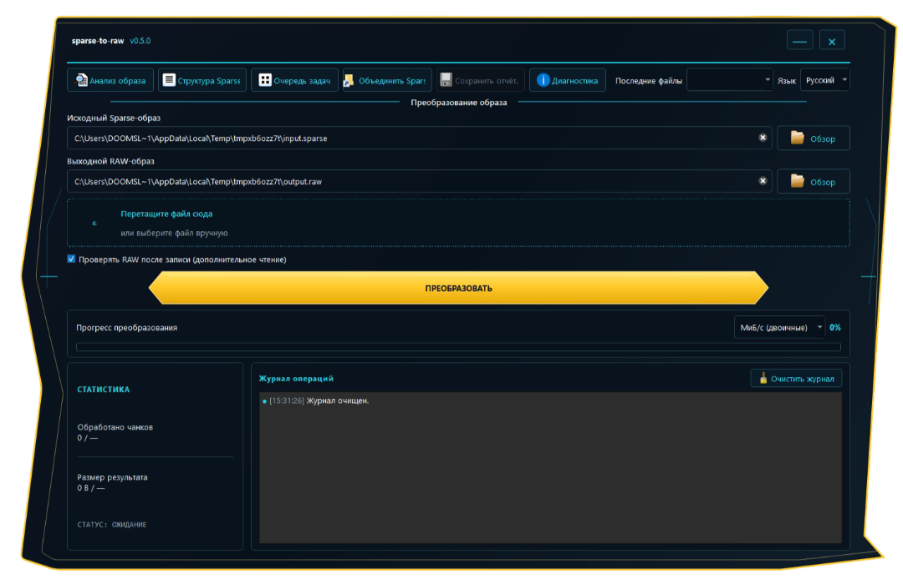

# sparse-to-raw

Потоковая утилита для анализа Android Sparse Image v1 и преобразования Sparse-образов в логическое RAW-содержимое. Проект включает CLI на Python без сторонних зависимостей и графический интерфейс PySide6 для Windows.

[](https://github.com/LIJTA3U/sparse-to-raw/actions/workflows/tests.yml)
[](https://www.python.org/)
[](LICENSE)
[](#требования)

**Язык:** [Русский](README.ru.md) · [English](README.md)

> **Статус: экспериментальная версия.** Реализация была побайтно сравнена с `simg2img.exe` на двух Android-образах: `super.img` (около 3,6 ГБ) из заводской прошивки Blackview и `userdata_exp.ai.img` (около 6,83 ГБ) из заводской прошивки Google Pixel. В обоих сравнениях различий не обнаружено. Результаты относятся к этим двум файлам и не заменяют независимое тестирование на других образах и устройствах.

## Возможности

- Преобразование Android Sparse Image версии 1 в логическое RAW-содержимое и кодирование RAW в Android Sparse v1.0.
- Поддержка чанков `RAW`, `FILL`, `DONT_CARE` и `CRC32`.
- Проверка CRC32 каждого чанка, общей контрольной суммы образа, заголовков, размеров и количества блоков, обрезанных данных и лишних байтов в конце через отдельный Sparse Validator.
- Анализ и проверка без создания RAW-файла (`--info`, `--verify-only`).
- Защита существующих выходных файлов: по умолчанию перезапись запрещена, для неё требуется `--force`.
- Индикатор прогресса, скорость, обработанный объём и количество чанков.
- Необязательный расчёт SHA-256 логического RAW-содержимого и экспорт JSON-отчётов.
- Проверка готового временного RAW повторным чтением, сравнением размера и SHA-256 с ожидаемым логическим содержимым (`--verify-output`).
- Объединение независимых Sparse-образов в явно указанном порядке (`--merge-parts`).
- Логическое сравнение RAW и/или Android Sparse без создания промежуточного RAW-файла (`compare`): поиск первого отличающегося байта и расчёт SHA-256 обоих логических образов.
- Анализ Qualcomm QFIL `rawprogram*.xml` / `patch*.xml`, поиск связанных файлов прошивки, сводка по разделам и сборка отдельного RAW на каждую физическую партицию (`qfil-analyze`, `qfil-build`). Patch-инструкции попадают в отчёт, но автоматически не применяются.
- Сохранение и загрузка версионированных JSON-профилей смешанной Batch Queue: Sparse → RAW, RAW → Sparse и QFIL.
- Экспорт подробных JSON-отчётов о конвертации, проверке результата, валидации, сравнении, QFIL и пакетных запусках.
- Потоковая обработка больших файлов без загрузки целого образа в оперативную память.
- CLI использует только стандартную библиотеку Python.
- GUI на PySide6: отдельные диалоги RAW → Sparse и логического сравнения образов, профили Batch Queue (JSON) для Sparse → RAW / RAW → Sparse / QFIL, поддержка смешанной пакетной очереди, русский/английский языки, сохранение настроек, история файлов, анализ, последовательная очередь конвертации, визуальное изменение порядка частей, проверка RAW после записи, центр диагностики, постраничный просмотр структуры Sparse с экспортом CSV/JSON и JSON-отчёты.

Области `DONT_CARE` интерпретируются как нулевые байты. Логический размер и содержимое RAW корректны; файловая система может физически хранить нулевые области как разреженные участки.

## Скачать для Windows

**Последний стабильный релиз:** [sparse-to-raw v0.5.0](https://github.com/LIJTA3U/sparse-to-raw/releases/tag/v0.5.0)  
**Кандидат v0.6.0:** [v0.6.0-rc1](https://github.com/LIJTA3U/sparse-to-raw/releases/tag/v0.6.0-rc1) (Windows EXE собираются через GitHub Actions после публикации кандидата).

В релизе доступны:

- `sparse-to-raw-gui-windows.zip` — рекомендуемый пакет GUI. Распакуйте архив целиком и запускайте `sparse-to-raw-gui.exe` из папки приложения.
- `sparse-to-raw-gui.exe` — отдельный исполняемый файл GUI.
- `sparse-to-raw.exe` — отдельная CLI-утилита.

Для запуска готовых Windows-приложений конечному пользователю не нужно устанавливать Python. Для обычного использования рекомендуется ZIP-пакет; не меняйте структуру извлечённой папки.

## Графический интерфейс Windows

GUI использует тёмную тему, угловую жёлтую рамку и бирюзовые акценты. Поддерживаются перетаскивание файлов, статистика прогресса, журнал операций, сохранение настроек, история последних входных файлов и отображение скорости в МБ/с, МиБ/с или Мбит/с.



Действие **«Анализ образа»** проверяет метаданные без создания RAW-файла. **«Очередь задач»** последовательно обрабатывает несколько файлов и сохраняет итоговый JSON-отчёт. **«Объединить Sparse»** позволяет изменить порядок независимых Sparse-образов перед объединением. Конвертация и анализ выполняются в рабочих потоках Qt; отмена удаляет временный результат и сохраняет существующий выходной файл.

См. [руководство по GUI](docs/ru/gui-guide.md) и [инструкцию по установке Windows](docs/ru/installation.md).

## Быстрый старт (CLI)

Для запуска из исходников требуется Python 3.10 или новее. CLI не требует сторонних Python-пакетов. По умолчанию CLI работает на английском; русский включается параметром `--lang ru` или переменной `SPARSE_TO_RAW_LANG=ru`. Подробности — в [руководстве CLI](docs/ru/cli-guide.md).

```bash
python sparse_to_raw.py input_sparse.img output_raw.img
```

Пример для Windows (`cmd`):

```bat
py sparse_to_raw.py super.img super_raw.img
```

Если выходной файл уже существует, конвертация остановится, не изменив его. Для явного разрешения перезаписи используйте:

```bat
py sparse_to_raw.py super.img super_raw.img --force
```

Проверить файл без конвертации:

```bash
python sparse_to_raw.py super.img --info
python sparse_to_raw.py super.img --verify-only
```

Вычислить SHA-256 логического RAW-содержимого и сохранить JSON-отчёт:

```bash
python sparse_to_raw.py super.img super_raw.img --sha256 --json-report report.json
```

Сравнить два образа по логическому содержимому (RAW и/или Android Sparse):

```bat
py sparse_to_raw.py compare left.raw right.sparse --json-report comparison.json
```

Команда возвращает код `0`, если образы идентичны, `1`, если они различаются, и `2`, если сравнение не удалось выполнить. Промежуточный RAW-файл не создаётся.

Объединить независимые Sparse-файлы в заданном порядке:

```bat
py sparse_to_raw.py --merge-parts super.img_sparsechunk.0 super.img_sparsechunk.1 --output super_raw.img --sha256
```

Каждый входной файл для объединения должен быть самостоятельным Sparse-образом с собственным заголовком. Этот режим не предназначен для объединения произвольных байтовых фрагментов одного Sparse-файла. GUI умеет находить группы файлов `super.img_sparsechunk.*` и сортировать их части по числовым индексам. Параметр CLI `--merge-parts` по-прежнему принимает список самостоятельных Sparse-образов в явно заданном порядке.

Полный список параметров и примеров находится в [руководстве CLI](docs/ru/cli-guide.md) и [руководстве по QFIL XML](docs/ru/qfil-xml.md). CLI также поддерживает `--verify-output`: перед публикацией результата временный RAW повторно читается, а его размер и SHA-256 сверяются с ожидаемым логическим содержимым.

## Документация

- [Установка](docs/ru/installation.md)
- [Руководство CLI](docs/ru/cli-guide.md)
- [Поддержка XML Qualcomm QFIL](docs/ru/qfil-xml.md)
- [Проверка выходного RAW](docs/ru/output-verification.md)
- [Руководство GUI](docs/ru/gui-guide.md)
- [Руководство по очереди заданий](docs/ru/task-queue.md)
- [Центр диагностики](docs/ru/diagnostic-center.md)
- [Просмотр структуры Sparse](docs/ru/sparse-structure-viewer.md)
- [Разработка и сборка](docs/ru/development.md)
- [Контрольный список релиза v0.6.0](docs/ru/release-checklist.md)
- [Заметки к кандидату релиза v0.6.0](RELEASE_NOTES_v0.6.0-rc1.ru.md)
- [История изменений](docs/ru/changelog.md)
- [Участие в разработке](docs/CONTRIBUTING.md)
- [Политика безопасности](docs/SECURITY.md)
- [Скриншоты](docs/screenshots/)

[English README](README.md) ведёт на англоязычную документацию в `docs/en/`.

## Кандидат релиза v0.6.0

Кандидат `v0.6.0-rc1` объединяет функциональность, разработанную в ветке v0.6.0: конвертацию RAW → Sparse, логическое сравнение RAW/Sparse без промежуточного RAW-файла, отдельный Sparse Validator, повторно используемые JSON-профили Batch Queue, расширенную интеграцию QFIL и структурированные JSON-отчёты. Также централизована версия CLI/GUI и добавлена автоматизация Windows-сборок CLI и GUI. Подробности приведены в [истории изменений на русском](docs/ru/changelog.md) и [английской истории изменений](docs/en/changelog.md).

## Тесты

Из корневого каталога проекта выполните:

```bash
python -m unittest discover -s tests -v
```

Основные тесты проверяют типы чанков, контрольные суммы, повреждённые и обрезанные данные, безопасную работу с выходными файлами, режимы анализа/проверки, объединение, SHA-256, JSON-отчёты, прогресс и отмену. QFIL-тесты дополнительно проверяют разбор rawprogram/patch XML, поиск файлов, секторные диапазоны, RAW-сборку, пересечения и обработку ошибок. GUI smoke-тесты проверяют пути, элементы интерфейса, языковые настройки и единицы скорости, историю файлов, рабочие потоки, анализ, пакетную обработку и точку входа self-test. GitHub Actions запускает основные тесты в Windows и Linux на Python 3.10–3.14; GUI-тесты также выполняются в Windows и Linux с PySide6.

## Ограничения и безопасность

- Проект экспериментальный и не является официальной заменой `simg2img` из AOSP.
- Независимое побайтовое сравнение выполнено на двух реальных образах, указанных выше. Для критически важных данных проверяйте результат отдельно.
- Утилита работает только с файлами. Она не подключается к телефону и не прошивает разделы устройства.
- Перед запуском проверьте входные/выходные пути и свободное место на диске. Для объединения требуется временное место под общий результат и раскрываемую текущую часть.
- GUI умеет автоматически находить группы Sparse-частей и сортировать их по числовым индексам. Для CLI-параметра `--merge-parts` по-прежнему необходимо указывать самостоятельные Sparse-образы в правильном порядке.

## Ссылки на формат

- [AOSP `sparse_format.h`](https://android.googlesource.com/platform/system/core/+/refs/heads/main/libsparse/include/sparse/sparse_format.h)
- [AOSP `sparse_read.cpp`](https://android.googlesource.com/platform/system/core/+/refs/heads/main/libsparse/sparse_read.cpp)
- [AOSP `simg2img.cpp`](https://android.googlesource.com/platform/system/core/+/refs/heads/main/libsparse/simg2img.cpp)

## Лицензия

[MIT](LICENSE).


## RAW → Android Sparse

CLI без сторонних зависимостей преобразует RAW в Android Sparse v1.0 потоково, с ограниченным использованием памяти. Нулевые блоки записываются как `DONT_CARE`, повторяющиеся 4-байтовые шаблоны — как `FILL`, остальные данные — как `RAW`. Размер блока настраивается (по умолчанию 4096 байт; должен быть кратен 4). Размер входного файла должен быть ненулевым и делиться на выбранный размер блока без остатка.

```powershell
py sparse_to_raw.py raw-to-sparse system.raw system.sparse --block-size 4096 --sha256
```

Для замены существующего файла используйте `--force`, для JSON-сводки — `--json-report report.json`. Результат сначала формируется во временном файле и сохраняется только после успешного завершения кодирования.
- [Заметки к кандидату релиза v0.6.0](RELEASE_NOTES_v0.6.0-rc1.md)
