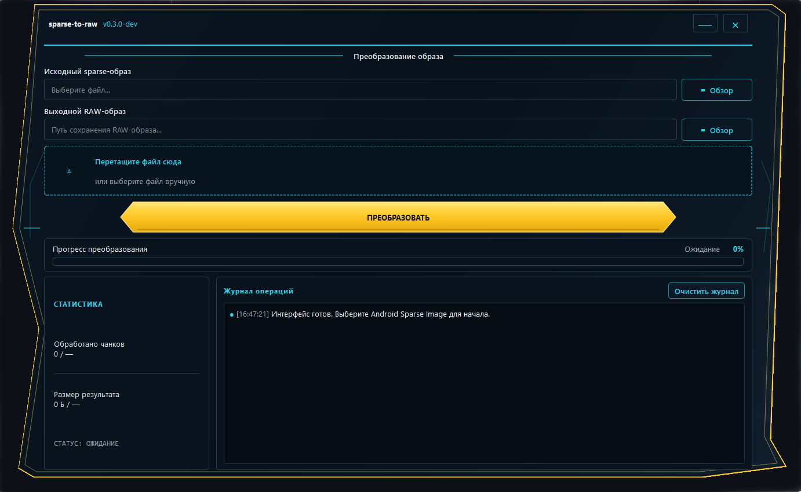

# sparse-to-raw

Небольшая CLI-утилита для проверки и преобразования Android Sparse Image в обычный RAW-образ. Написана на Python и использует только стандартную библиотеку.

[](https://github.com/LIJTA3U/sparse-to-raw/actions/workflows/tests.yml)
[](https://www.python.org/)
[](LICENSE)
[](#требования)

**Язык:** [Русский](README.ru.md) · [English](README.md)

> **Статус: экспериментальная версия.** Реализация была побайтно сравнена с `simg2img.exe` на двух Android-образах: `super.img` размером около 3,6 ГБ из заводской прошивки Blackview и `userdata_exp.ai.img` размером около 6,83 ГБ из заводской прошивки Google Pixel. В обоих случаях различий не обнаружено. Это подтверждает корректность преобразования для данных файлов, но не заменяет независимое тестирование на разных образах и устройствах.

## Возможности

- Конвертация Android Sparse Image версии 1 в RAW.
- Поддержка чанков `RAW`, `FILL`, `DONT_CARE` и `CRC32`.
- Проверка CRC32 отдельных чанков и общей контрольной суммы образа.
- Проверка структуры заголовков, размера блоков, количества блоков, обрезанных данных и лишних байтов в конце.
- Режимы информации и проверки без создания RAW-файла: `--info` и `--verify-only`.
- Защита существующих файлов: перезапись запрещена по умолчанию, для неё нужен `--force`.
- Индикатор прогресса, скорость и объём обработанных данных.
- Необязательный SHA-256 логического RAW-содержимого и JSON-отчёт.
- Объединение независимых частей Sparse-образа через `--merge-parts` в явно указанном порядке.
- Потоковая обработка больших образов без загрузки всего файла в оперативную память.
- CLI-версия использует только стандартную библиотеку Python.
- GUI на PySide6: выбор русского/английского языка, сохранение настроек и последних файлов.
- Переключение скорости отображения: МБ/с, МиБ/с или Мбит/с.
- Анализ Sparse-образа без создания RAW-файла с экспортом JSON-отчёта.
- Очередь пакетной конвертации с последовательной обработкой и итоговым отчётом.
- Визуальное объединение независимых Sparse-частей с изменением порядка.
- Иконка приложения и более крупные значки действий.
- Сохранение подробного отчёта после конвертации или объединения.

Области `DONT_CARE` интерпретируются как нулевые байты. Файловая система может физически хранить их как разреженные участки, не занимая место под каждый ноль; логический размер и читаемое содержимое остаются корректными.

## Требования

- Python 3.10 или новее для запуска из исходников.
- CLI не требует сторонних Python-пакетов.
- Для графического интерфейса разработчикам нужен PySide6: `python -m pip install -r requirements-gui.txt`.
- Свободное место на диске, достаточное для RAW-образа. Ожидаемый размер выводится при проверке и конвертации.

## Графический интерфейс Windows

В версии `v0.4.0` GUI на PySide6 дополнен переключением языка (Русский / English), единиц скорости (МБ/с, МиБ/с и Мбит/с), иконкой приложения, сохранением настроек и списка последних файлов. Кроме конвертации, в интерфейсе доступны анализ Sparse-образа, очередь пакетной обработки, визуальное объединение независимых Sparse-частей и экспорт подробных JSON-отчётов. Интерфейс вызывает те же функции ядра, что и CLI.



Подробная инструкция для разработчиков, включая установку Qt-зависимостей, headless-тесты и сборку PyInstaller, находится в [GUI_DEVELOPMENT.md](GUI_DEVELOPMENT.md).

Запуск GUI из исходников:

```bat
py -m pip install -r requirements-gui.txt
py sparse_to_raw_gui.py
```

Иконка приложения хранится в `assets/sparse-to-raw.ico`. Выбор языка и единиц скорости находится в главном окне; настройки сохраняются через Qt `QSettings`. В меню «Анализ образа» доступна проверка и экспорт метаданных в JSON, «Очередь задач» обрабатывает несколько образов последовательно, а «Объединить Sparse» позволяет вручную менять порядок независимых частей перед объединением.

Конвертация и анализ выполняются в рабочих потоках Qt. В окне показываются фактический прогресс, размер, скорость и диагностический журнал; отмена удаляет временный результат и не заменяет готовый выходной файл. Выбранный язык, единицы скорости, последние файлы, пути и размер окна сохраняются между запусками. Очередь создаёт подробный JSON-отчёт в папке назначения; отчёты анализа, конвертации и объединения можно сохранить вручную. При выборе уже существующего выходного файла приложение спрашивает подтверждение.

Для конечных пользователей Python устанавливать не нужно: на странице [Releases](https://github.com/LIJTA3U/sparse-to-raw/releases) будет доступен архив `sparse-to-raw-gui-windows.zip` с EXE и библиотеками. Дополнительно публикуется однофайловый `sparse-to-raw-gui.exe`; архив с папкой приложения рекомендуется как основной вариант для диагностики и более быстрого запуска.

## Быстрый старт

```bash
python sparse_to_raw.py input_sparse.img output_raw.img
```

Пример для Windows (`cmd`):

```bat
py sparse_to_raw.py super.img super_raw.img
```

Если `super_raw.img` уже существует, программа остановится, не изменив его. Разрешить перезапись можно явно:

```bat
py sparse_to_raw.py super.img super_raw.img --force
```

## Команды

### Информация об образе без конвертации

```bash
python sparse_to_raw.py super.img --info
```

Программа проверит структуру файла и контрольные суммы, выведет версию формата, размер блока, ожидаемый RAW-размер и количество чанков каждого типа. Выходной образ создаваться не будет.

### Проверка без создания RAW

```bash
python sparse_to_raw.py super.img --verify-only
```

Подходит для предварительной проверки файла. При повреждённой структуре или неверной контрольной сумме программа завершится с ошибкой и ненулевым кодом возврата.

### SHA-256 и JSON-отчёт

```bash
python sparse_to_raw.py super.img super_raw.img --sha256 --json-report report.json
```

SHA-256 рассчитывается по логическому содержимому будущего RAW-образа, в том числе по нулевым областям `DONT_CARE`. JSON-отчёт содержит метаданные, количества чанков и вычисленные контрольные суммы. Если файл отчёта уже существует, используйте `--force`, чтобы заменить его.

### Объединить независимые Sparse-части

Если прошивка содержит несколько независимых Sparse-файлов, которые вместе образуют один RAW-образ, их можно объединить в указанном порядке:

```bat
py sparse_to_raw.py --merge-parts super.img_sparsechunk.0 super.img_sparsechunk.1 --output super_raw.img --sha256
```

Добавьте остальные части в правильном числовом порядке. Каждая часть должна быть самостоятельным корректным Android Sparse Image с собственным заголовком; программа проверяет каждую часть отдельно и не публикует итоговый файл, если хотя бы одна проверка завершается ошибкой. Не используйте этот режим для частей, которые являются лишь произвольным побайтовым разрезанием одного sparse-файла.

### Отключить индикатор прогресса

```bash
python sparse_to_raw.py super.img super_raw.img --quiet
```

## Сборка для Windows

PyInstaller и PySide6 нужны только для разработки и упаковки, а не для конечного пользователя:

```bat
py -m pip install -r requirements-build.txt
py -m PyInstaller --clean --onefile --name sparse-to-raw sparse_to_raw.py
py -m PyInstaller --clean --windowed --onedir --name sparse-to-raw-gui --icon assets/sparse-to-raw.ico --add-data "assets/sparse-to-raw.ico;assets" sparse_to_raw_gui.py
```

CLI EXE появится в `dist\sparse-to-raw.exe`, GUI — в папке `dist\sparse-to-raw-gui`. В workflow сборки GUI дополнительно упаковывается в ZIP, а также создаётся однофайловый GUI EXE. Workflow **Build Windows applications** прикладывает результаты к GitHub Release и проводит smoke-test GUI EXE при скрытом из `PATH` Python.

## Тесты

Из корневого каталога проекта выполните:

```bash
python -m unittest discover -s tests -v
```

Тесты проверяют типы чанков, корректные и ошибочные CRC, общую контрольную сумму, обрезанные и повреждённые данные, размер завершающего `DONT_CARE`, защиту существующего файла, режимы проверки, объединение Sparse-частей, SHA-256 и JSON-отчёт. GitHub Actions запускает тесты автоматически для нескольких версий Python в Windows и Linux.

## Ограничения и безопасность

- Проект экспериментальный и не является официальной заменой `simg2img` из AOSP.
- Сравнение с независимой реализацией выполнено на одном большом реальном `super.img`; для критически важных образов проверяйте результаты независимо.
- Утилита не подключается к телефону и не прошивает разделы: она только читает входной файл и, при конвертации, создаёт выходной.
- Перед запуском проверьте пути и свободное место на диске. При объединении потребуется место для итогового временного RAW-файла и временно раскрываемой текущей части. Не используйте образ после ошибки проверки.
- Файлы `super.img_sparsechunk.*` не объединяются автоматически: для объединения используйте `--merge-parts`, передав только самостоятельные Sparse-файлы и указав правильный порядок вручную.

## Ссылки на формат

- [AOSP `sparse_format.h`](https://android.googlesource.com/platform/system/core/+/refs/heads/main/libsparse/include/sparse/sparse_format.h) — заголовок и типы чанков.
- [AOSP `sparse_read.cpp`](https://android.googlesource.com/platform/system/core/+/refs/heads/main/libsparse/sparse_read.cpp) — разбор Sparse и проверки CRC.
- [AOSP `simg2img.cpp`](https://android.googlesource.com/platform/system/core/+/refs/heads/main/libsparse/simg2img.cpp) — реализация конвертера.

## Участие в разработке

Баг-репорты, тестовые файлы без персональных данных и pull request приветствуются. Перед отправкой изменений запустите тесты и ознакомьтесь с [CONTRIBUTING.md](CONTRIBUTING.md).

## Лицензия

[MIT](LICENSE).
