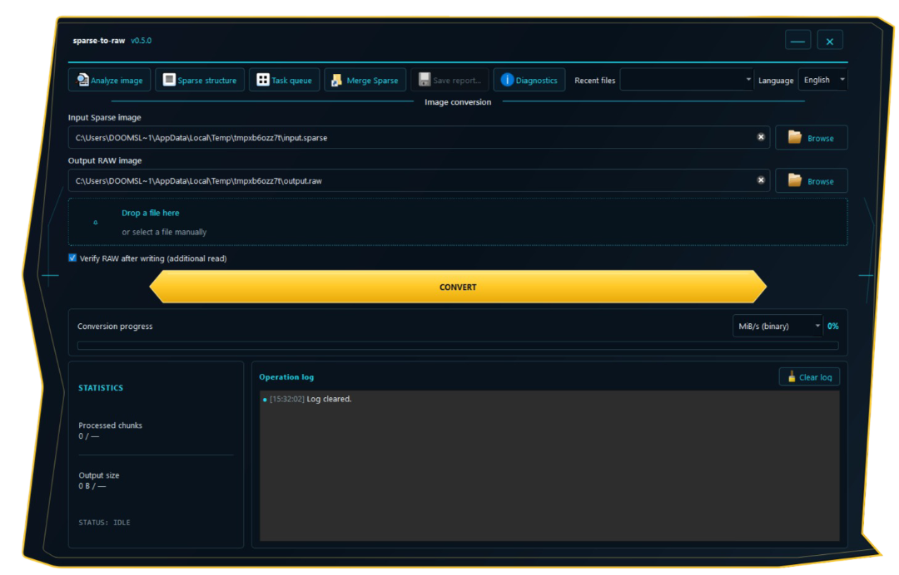

# GUI guide

The Windows GUI is built with PySide6 and calls the same conversion and validation functions as the CLI. It does not contain a separate Sparse parser.

## Main conversion window

1. Select an input Sparse image with **Browse**, drag a file onto the drop zone, or choose a recent input.
2. Choose the destination RAW path. The application suggests a name based on the input filename.
3. Press **Convert**.
4. Review progress, processed chunks/bytes, throughput, status, and the operation log.

If the destination already exists, the GUI asks before replacing it. The output is committed only after validation succeeds. A cancellation removes temporary output and preserves a pre-existing destination.

## Verify the written RAW output (development branch)

The main conversion window, batch queue, and Merge Sparse dialog provide a **Verify RAW after writing** option. The preference is saved between launches and is enabled by default in the current development branch. When enabled, the application re-reads the completed staging RAW file and compares its exact size and SHA-256 with the expected logical contents before publishing it at the destination.

This adds an additional read pass and can noticeably increase disk activity and processing time for large images. If verification fails or the operation is cancelled, the staging file is removed and an existing destination is left unchanged. The result report includes the verification method, hashes, byte count, and duration. This feature is part of v0.5.0 development and is not included in the v0.4.0 release binaries.

## Language and speed units

Use the language selector to switch between Russian and English. The speed selector supports decimal MB/s, binary MiB/s, and Mbit/s. Preferences, window geometry, last paths, and the recent input list are stored using Qt `QSettings`.

## Analyze image

**Analyze image** validates the Sparse image and displays metadata without producing a RAW file. The result can be exported as JSON.

## Task queue

**Task queue** lets you add multiple input images and process them sequentially into a selected output folder. Drag items to reorder them before starting; the up/down controls are also available. While running, select one or more waiting/running items to cancel or skip them individually. A running task is cancelled at the converter's next safe cancellation point; a pending task is marked immediately. Pause takes effect between files, so the active file is not suspended mid-write. Failed, cancelled, and skipped items can be selected and retried after the run. Use the status filter to focus on waiting, running, successful, failed, cancelled, or skipped items. The progress bar reports overall queue progress and the JSON summary includes per-item states. A failed item does not stop the remaining queue.

For detailed queue controls, pause/cancel behavior, retries, and status filters, see [Advanced task queue](task-queue.md).

## Merge Sparse

**Merge Sparse** accepts independent Sparse images. Add the files, arrange them in the correct order with the move controls, select an output path, and start the merge. Every part must contain its own valid Sparse header. This feature does not reassemble arbitrary byte ranges cut from one Sparse file.

## Reports and diagnostics

The main window keeps a bounded operation log. Open **Diagnostics** from the toolbar to browse the persistent event history, filter by severity, operation, and date, and search messages/details. The Diagnostic Center records operation duration, processed/output bytes, chunk counts, and average throughput where those metrics are available. Logs are locally stored with rotation.

Use **Export ZIP** to create a sanitized troubleshooting bundle containing JSONL events and basic runtime-version information. Sparse/RAW files, conversion reports, recent-file lists, environment variables, account names, and computer names are not added. User profile roots and common credential-shaped values are redacted. Review the archive before sharing it, because useful file names or other context may remain. See [Diagnostic Center](diagnostic-center.md).

Conversion, analysis, and merge results can still be exported as JSON where the corresponding report action is available. Batch conversion writes its summary to the output folder; these reports are separate from the diagnostic ZIP.

## Sparse Structure Viewer

Use **Sparse structure** to inspect the chunk layout after a full validation. The paged table shows chunk index/type, file and logical RAW offsets, block count, stored/expanded sizes, CRC32 checkpoint values, and validation status. Filter by `RAW`, `FILL`, `DONT_CARE`, or `CRC32`, or search by index, offset, size, or checksum. Pages contain up to 200 rows and are scanned without retaining the complete table in memory.

CSV and JSON structure exports run in a background worker, show progress, and support cancellation. The export contains metadata and chunk layout, not the RAW payload. The viewer checks the source file identity after validation; if the file changes, validate it again before paging or exporting. See [Sparse Structure Viewer](sparse-structure-viewer.md).

## Windows packages

The recommended download is `sparse-to-raw-gui-windows.zip`. Extract the entire package and run `sparse-to-raw-gui.exe` from its folder. Do not move the executable away from its bundled libraries. The one-file executable is also provided, but can start more slowly while its bundled files are unpacked.

## Windows icon and localized operation log

The GUI sets the bundled `assets/sparse-to-raw.ico` as both the application and main-window icon and assigns a stable Windows AppUserModelID before creating `QApplication`. This allows Windows to show and group the application with its own taskbar icon when launched from the packaged executable. When running from source, the same icon is set on the Qt application/window.

Known operation-log messages are rendered in the currently selected UI language. Event records retain stable source messages and structured categories so the Diagnostic Center can re-render them after switching between Russian and English. The custom dark/cyan/yellow shell is retained; its slanted left contour is painted with antialiased curved paths rather than a pixel-clipping mask.
