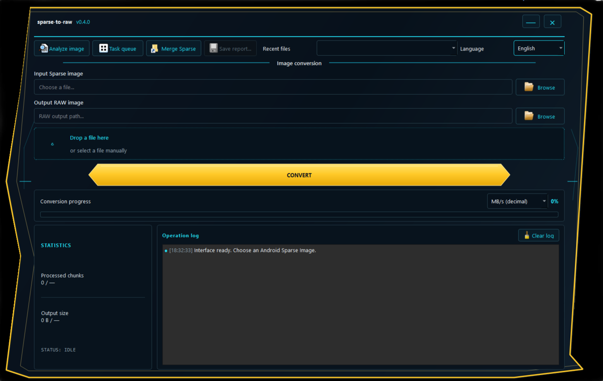

# GUI guide

The Windows GUI is built with PySide6 and calls the same conversion and validation functions as the CLI. It does not contain a separate Sparse parser.

## Main conversion window

1. Select an input Sparse image with **Browse**, drag a file onto the drop zone, or choose a recent input.
2. Choose the destination RAW path. The application suggests a name based on the input filename.
3. Press **Convert**.
4. Review progress, processed chunks/bytes, throughput, status, and the operation log.

If the destination already exists, the GUI asks before replacing it. The output is committed only after validation succeeds. A cancellation removes temporary output and preserves a pre-existing destination.

## Language and speed units

Use the language selector to switch between Russian and English. The speed selector supports decimal MB/s, binary MiB/s, and Mbit/s. Preferences, window geometry, last paths, and the recent input list are stored using Qt `QSettings`.

## Analyze image

**Analyze image** validates the Sparse image and displays metadata without producing a RAW file. The result can be exported as JSON.

## Task queue

**Task queue** lets you add multiple input images and process them sequentially into a selected output folder. The queue writes a JSON summary. If one item fails, the remaining items can continue. The application rejects items that would generate duplicate output filenames.

## Merge Sparse

**Merge Sparse** accepts independent Sparse images. Add the files, arrange them in the correct order with the move controls, select an output path, and start the merge. Every part must contain its own valid Sparse header. This feature does not reassemble arbitrary byte ranges cut from one Sparse file.

## Reports and diagnostics

The main window keeps a bounded operation log. Conversion, analysis, and merge results can be exported as JSON where the corresponding report action is available. Batch conversion writes its summary to the output folder.

Review reports before sharing them: they may contain local file paths and diagnostic messages from the system.

## Windows packages

The recommended download is `sparse-to-raw-gui-windows.zip`. Extract the entire package and run `sparse-to-raw-gui.exe` from its folder. Do not move the executable away from its bundled libraries. The one-file executable is also provided, but can start more slowly while its bundled files are unpacked.
