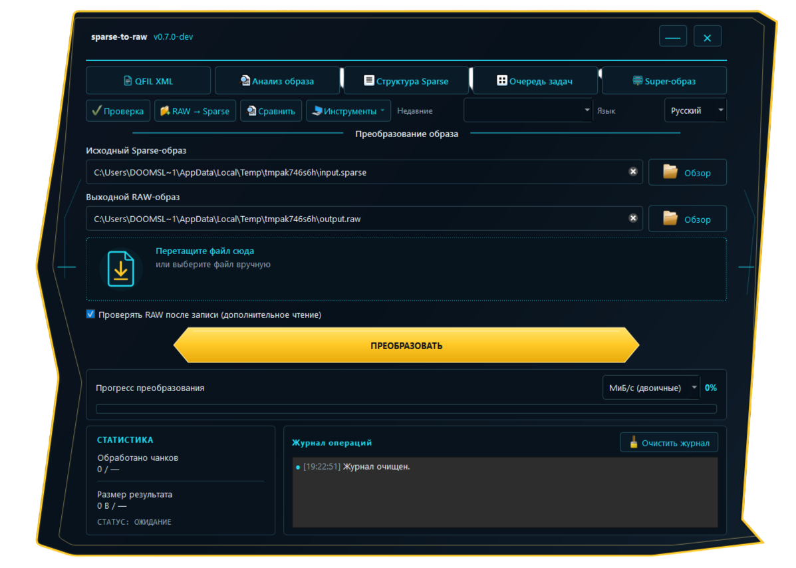

# Руководство GUI

Графический интерфейс Windows создан на PySide6 и вызывает те же функции конвертации и проверки, что и CLI. В GUI нет отдельной реализации парсера Sparse.

## Панель инструментов

Панель разделена на две компактные строки. В первой находятся основные разделы: QFIL XML, анализ образа, структура Sparse, очередь задач и Super-образ. Во второй — часто используемые действия проверки, RAW → Sparse и сравнения. Команды объединения Sparse, сохранения отчёта и центр диагностики собраны в меню **«Инструменты»**; наведите курсор на кнопку или пункт, чтобы увидеть подсказку. Переключатели последних файлов и языка остаются справа.

## Главное окно конвертации

1. Выберите исходный Sparse-образ через **«Обзор»**, перетащите файл в область перетаскивания или выберите его из последних файлов.
2. Укажите путь для RAW. Программа предлагает имя на основе исходного файла.
3. Нажмите **«Преобразовать»**.
4. Следите за прогрессом, количеством обработанных чанков и байтов, скоростью, статусом и журналом операций.

Если выходной файл уже существует, GUI запросит подтверждение. Результат публикуется только после успешной проверки. При отмене временный файл удаляется, а уже существующий результат сохраняется.

## Проверка записанного RAW (ветка разработки)

В главном окне конвертации, очереди задач и диалоге «Объединить Sparse» есть параметр **«Проверять RAW после записи»**. Настройка сохраняется между запусками; в текущей ветке разработки она включена по умолчанию. Если параметр активен, приложение повторно читает готовый временный RAW и до публикации результата сравнивает его точный размер и SHA-256 с ожидаемым логическим содержимым.

Проверка добавляет дополнительный проход чтения и может заметно увеличить дисковую нагрузку и время обработки больших образов. При ошибке проверки или отмене временный файл удаляется, а существующий результат остаётся без изменений. Отчёт содержит метод проверки, хеши, количество байтов и длительность. Функция добавлена в v0.5.0 и входит в опубликованную ветку релизов v0.5.0, а также в кандидат релиза v0.6.0 и релизную ветку.

## Язык и единицы скорости

Переключатель языка позволяет выбрать русский или английский. Для скорости доступны МБ/с (десятичные), МиБ/с (двоичные) и Мбит/с. Настройки, геометрия окна, последние пути и история входных файлов сохраняются через Qt `QSettings`.

## Логическое сравнение образов

Нажмите **«Сравнить»** на главной панели, чтобы сравнить любые два RAW- и/или Android Sparse-файла по их раскрытому логическому содержимому. Выберите оба входных файла и запустите сравнение. Операция выполняется в фоновом потоке, показывает прогресс, поддерживает отмену и не создаёт промежуточные RAW-файлы. Во время чтения проверяются структура Sparse и контрольные суммы. Результат показывает, совпадают ли логические данные, SHA-256 обоих образов, их логические размеры и смещение первого отличающегося байта. Кнопка **«Сохранить JSON»** экспортирует отчёт.

## Анализ образа

Действие **«Анализ образа»** проверяет Sparse-файл и показывает метаданные без создания RAW. Результат можно экспортировать в JSON.

## Очередь задач

В окне **«Очередь задач»** можно добавить несколько исходных файлов и последовательно обработать их в выбранную папку. До запуска порядок можно менять перетаскиванием или кнопками вверх/вниз. Во время работы можно выбрать одно или несколько ожидающих/выполняющихся заданий и отменить либо пропустить их. Текущая задача отменяется на ближайшей безопасной точке отмены конвертера; ожидающая помечается сразу. Пауза применяется между файлами: активная запись не приостанавливается посреди операции. После завершения можно выбрать задания со статусами «Ошибка», «Отменено» или «Пропущено» и повторить их. Фильтр позволяет показывать ожидающие, выполняющиеся, успешные, ошибочные, отменённые или пропущенные задания. Индикатор отображает общий прогресс, а JSON-отчёт содержит состояния отдельных файлов. Ошибка одного элемента не останавливает остальные задания.

Подробное описание управления очередью, паузы, отмены, повторов и фильтров см. в разделе [«Расширенная очередь заданий»](task-queue.md). Профили JSON позволяют сохранить и восстановить состав и порядок очереди, типы задач Sparse → RAW / RAW → Sparse / QFIL, выходные пути и общие настройки. При загрузке профиля текущая очередь заменяется после подтверждения, а все восстановленные задания получают статус ожидания.

## Объединение Sparse

Окно **«Объединить Sparse»** принимает независимые Sparse-образы. Добавьте файлы, установите правильный порядок кнопками перемещения, укажите путь результата и запустите объединение. Каждый файл должен содержать собственный корректный Sparse-заголовок. Функция не собирает произвольные байтовые фрагменты одного Sparse-файла.

## Отчёты и диагностика

В главном окне ведётся ограниченный по размеру журнал операций. Откройте **«Диагностика»** на панели инструментов, чтобы просматривать постоянную историю событий, фильтровать её по уровню, операции и периоду, а также искать по сообщениям и дополнительным сведениям. Центр диагностики записывает длительность операции, объём обработанных и выходных данных, число чанков и среднюю скорость, если эти показатели доступны. Локальные журналы ротируются.

Кнопка **«Экспорт ZIP»** создаёт обезличенный архив для диагностики: события JSONL и базовые сведения о версиях среды. Sparse/RAW-файлы, отчёты конвертации, история последних файлов, переменные окружения, имена учётных записей и компьютера не добавляются. Корни пользовательских профилей и типичные значения, похожие на секреты, маскируются. Перед отправкой просмотрите архив: в нём могут оставаться имена файлов и другой контекст. Подробнее — [«Центр диагностики»](diagnostic-center.md).

Отчёты конвертации, анализа и объединения по-прежнему можно экспортировать в JSON, если соответствующее действие доступно. Пакетная очередь сохраняет сводку в папке назначения; эти отчёты не входят в диагностический ZIP.

## Просмотр структуры Sparse

Нажмите **«Структура Sparse»**, чтобы посмотреть расположение чанков после полной проверки файла. Постраничная таблица показывает индекс и тип чанка, смещения в Sparse и логическом RAW, число блоков, размеры в файле и после распаковки, контрольные точки CRC32 и статус проверки. Доступны фильтры `RAW`, `FILL`, `DONT_CARE`, `CRC32` и поиск по индексу, смещению, размеру или контрольной сумме. На странице отображается до 200 строк; полная таблица не хранится в оперативной памяти.

Экспорт структуры в CSV и JSON выполняется в фоновом потоке, показывает прогресс и поддерживает отмену. Экспорт содержит метаданные и структуру чанков, но не полезные данные RAW. Программа проверяет идентичность исходного файла после полной проверки; если файл изменился, его нужно проверить заново перед просмотром страниц или экспортом. Подробнее — [«Просмотр структуры Sparse»](sparse-structure-viewer.md).

## Windows-пакеты

Рекомендуемый вариант — `sparse-to-raw-gui-windows.zip`. Распакуйте архив целиком и запускайте `sparse-to-raw-gui.exe` из его папки. Не перемещайте EXE отдельно от библиотек. Также доступен однофайловый EXE, но его запуск может занимать больше времени из-за распаковки встроенных компонентов.

## Иконка Windows и локализация журнала операций

GUI устанавливает `assets/sparse-to-raw.ico` как иконку приложения и главного окна, а также задаёт постоянный Windows AppUserModelID до создания `QApplication`. Благодаря этому Windows может показывать собственную иконку приложения и корректно группировать окно на панели задач при запуске собранного EXE. При запуске из исходников та же иконка устанавливается для Qt-приложения и окна.

Известные сообщения журнала операций отображаются на выбранном языке интерфейса. Внутри события сохраняются со стабильными исходными сообщениями и категориями, поэтому Центр диагностики может повторно отобразить историю после переключения между русским и английским. Существующая тёмная тема с бирюзовыми и жёлтыми акцентами сохранена; наклонная левая часть рамки рисуется сглаженными кривыми, без пиксельной маски обрезки.

## Sparse Validator

Нажмите **«Проверка»** на нижней панели, чтобы открыть отдельный Sparse Validator. Выберите Android Sparse-образ и запустите проверку. Окно показывает прогресс, сведения о заголовке и чанках, результаты CRC32 и общей контрольной суммы, предупреждения и ошибки, а также SHA-256 логического содержимого. Проверку можно отменить, отчёт — сохранить в JSON. Образ читается потоково с ограниченным использованием памяти; промежуточный RAW-файл не создаётся.

## Инструменты Android Super Image

Откройте **«Super-образ»** в первой строке панели инструментов. Диалог читает LP-геометрию и метаданные, показывает разделы, размеры, группы, extents и атрибуты. Источник может быть RAW или Android Sparse; Sparse автоматически раскрывается во временный RAW без изменения оригинала. Выберите слот метаданных, нажмите «Прочитать структуру», отметьте нужные разделы и извлеките их в выбранный каталог. Извлечение выполняется в фоновом потоке, поддерживает прогресс и отмену. Если изменить путь к источнику или слот после анализа, таблица сбрасывается и требуется повторное чтение. Поддерживаются LP metadata 10.0–10.2; пока не поддерживаются многобразные retrofit-конфигурации, где extents используют block device с индексом, отличным от 0. См. [подробное руководство Super Image](super-image.md).

## AVB / VBMeta Inspector

Откройте **AVB / VBMeta Inspector** в меню **«Инструменты»**. Выберите самостоятельный `vbmeta.img` или образ Android-раздела с AVB footer и нажмите **«Прочитать метаданные»**. В сводке показаны алгоритм AVB, rollback index, количество descriptors и состояние встроенного хеша. Таблица содержит поддерживаемые descriptors типов Property, Hash, Hashtree, Kernel Cmdline и Chain Partition; при выборе строки полные разобранные поля отображаются в панели сведений. После анализа JSON-отчёт можно сохранить действием отчёта в главном окне.

Инспектор проверяет границы контейнера VBMeta и встроенный хеш, если алгоритм поддерживается. Он **не** проверяет RSA-подпись, не устанавливает доверие к публичному ключу и не сравнивает rollback state с подключённым устройством. Это диагностический просмотрщик только для чтения, а не инструмент проверки AVB или прошивки. См. [руководство AVB / VBMeta](avb-vbmeta.md).

## Android Boot Image Inspector

Откройте **«Инструменты» → Boot Image Inspector**, выберите `boot.img`, `init_boot.img`, `recovery.img` или `vendor_boot.img` и нажмите **«Прочитать структуру»**. Таблица показывает разобранные компоненты, их абсолютные смещения в файле, размеры в байтах и подсказки о формате по сигнатуре. Выберите строку, чтобы увидеть подробные сведения. **«Экспорт JSON»** сохраняет полный отчёт. Диалог работает только на чтение: он не распаковывает ramdisk, не извлекает компоненты и не изменяет образ. Версии заголовков и ограничения описаны в [руководстве Boot Image Inspector](boot-image.md).

## Android Ramdisk Inspector

Откройте **«Инструменты» → Ramdisk Inspector**, выберите `boot.img`, `init_boot.img`, `recovery.img`, `vendor_boot.img` или отдельный сжатый CPIO-архив и нажмите **«Просмотреть содержимое»**. Для `vendor_boot` v4 с несколькими фрагментами включите переключатель выбора и укажите индекс с нуля. В таблице отображаются пути, типы записей, размеры в байтах, биты прав и статус CPIO CRC. Выберите строки и нажмите **«Извлечь выбранное»** или используйте **«Извлечь всё»**; выбор каталога включает вложенные записи. Распаковка, анализ CPIO и извлечение выполняются в рабочем потоке и поддерживают отмену. Лимит распакованного архива по умолчанию — 512 МиБ, его можно изменить в окне. **«Экспорт JSON»** сохраняет список записей. Изменение пути источника или выбранного фрагмента сбрасывает предыдущую инвентаризацию. Символические ссылки и специальные файлы перечисляются в текстовых манифестах, а не создаются как ссылки или узлы устройств. Кнопка **«Сравнить конфиги…»** позволяет выбрать два найденных текстовых файла, например `fstab.mt6762` и `fstab.mt6765`, и открыть построчное сравнение с подсветкой добавленных, удалённых и изменённых строк. Поддерживаемые форматы и ограничения описаны в [руководстве Ramdisk Inspector](ramdisk-inspector.md).

