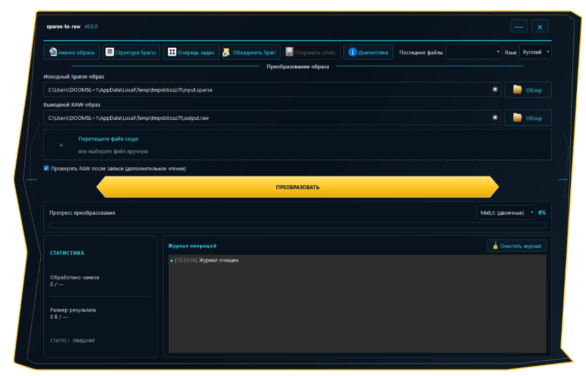

# Руководство GUI

Графический интерфейс Windows создан на PySide6 и вызывает те же функции конвертации и проверки, что и CLI. В GUI нет отдельной реализации парсера Sparse.

## Главное окно конвертации

1. Выберите исходный Sparse-образ через **«Обзор»**, перетащите файл в область перетаскивания или выберите его из последних файлов.
2. Укажите путь для RAW. Программа предлагает имя на основе исходного файла.
3. Нажмите **«Преобразовать»**.
4. Следите за прогрессом, количеством обработанных чанков и байтов, скоростью, статусом и журналом операций.

Если выходной файл уже существует, GUI запросит подтверждение. Результат публикуется только после успешной проверки. При отмене временный файл удаляется, а уже существующий результат сохраняется.

## Проверка записанного RAW (ветка разработки)

В главном окне конвертации, очереди задач и диалоге «Объединить Sparse» есть параметр **«Проверять RAW после записи»**. Настройка сохраняется между запусками; в текущей ветке разработки она включена по умолчанию. Если параметр активен, приложение повторно читает готовый временный RAW и до публикации результата сравнивает его точный размер и SHA-256 с ожидаемым логическим содержимым.

Проверка добавляет дополнительный проход чтения и может заметно увеличить дисковую нагрузку и время обработки больших образов. При ошибке проверки или отмене временный файл удаляется, а существующий результат остаётся без изменений. Отчёт содержит метод проверки, хеши, количество байтов и длительность. Функция входит в разработку v0.5.0 и отсутствует в бинарных файлах релиза v0.4.0.

## Язык и единицы скорости

Переключатель языка позволяет выбрать русский или английский. Для скорости доступны МБ/с (десятичные), МиБ/с (двоичные) и Мбит/с. Настройки, геометрия окна, последние пути и история входных файлов сохраняются через Qt `QSettings`.

## Анализ образа

Действие **«Анализ образа»** проверяет Sparse-файл и показывает метаданные без создания RAW. Результат можно экспортировать в JSON.

## Очередь задач

В окне **«Очередь задач»** можно добавить несколько исходных файлов и последовательно обработать их в выбранную папку. До запуска порядок можно менять перетаскиванием или кнопками вверх/вниз. Во время работы можно выбрать одно или несколько ожидающих/выполняющихся заданий и отменить либо пропустить их. Текущая задача отменяется на ближайшей безопасной точке отмены конвертера; ожидающая помечается сразу. Пауза применяется между файлами: активная запись не приостанавливается посреди операции. После завершения можно выбрать задания со статусами «Ошибка», «Отменено» или «Пропущено» и повторить их. Фильтр позволяет показывать ожидающие, выполняющиеся, успешные, ошибочные, отменённые или пропущенные задания. Индикатор отображает общий прогресс, а JSON-отчёт содержит состояния отдельных файлов. Ошибка одного элемента не останавливает остальные задания.

Подробное описание управления очередью, паузы, отмены, повторов и фильтров см. в разделе [«Расширенная очередь заданий»](task-queue.md).

## Объединение Sparse

Окно **«Объединить Sparse»** принимает независимые Sparse-образы. Добавьте файлы, установите правильный порядок кнопками перемещения, укажите путь результата и запустите объединение. Каждый файл должен содержать собственный корректный Sparse-заголовок. Функция не собирает произвольные байтовые фрагменты одного Sparse-файла.

## Отчёты и диагностика

В главном окне ведётся ограниченный по размеру журнал операций. Результаты конвертации, анализа и объединения можно экспортировать в JSON, если соответствующее действие отчёта доступно. Пакетная очередь сохраняет сводку в папке назначения.

Перед отправкой отчётов другим людям проверьте их содержимое: в них могут присутствовать локальные пути к файлам и диагностические сообщения системы.

## Windows-пакеты

Рекомендуемый вариант — `sparse-to-raw-gui-windows.zip`. Распакуйте архив целиком и запускайте `sparse-to-raw-gui.exe` из его папки. Не перемещайте EXE отдельно от библиотек. Также доступен однофайловый EXE, но его запуск может занимать больше времени из-за распаковки встроенных компонентов.
